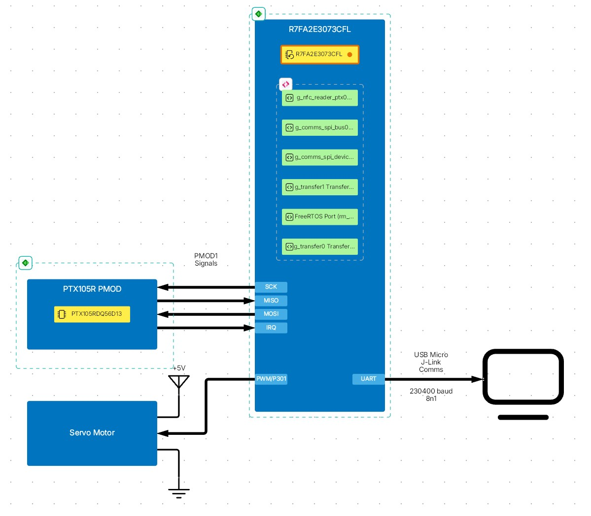
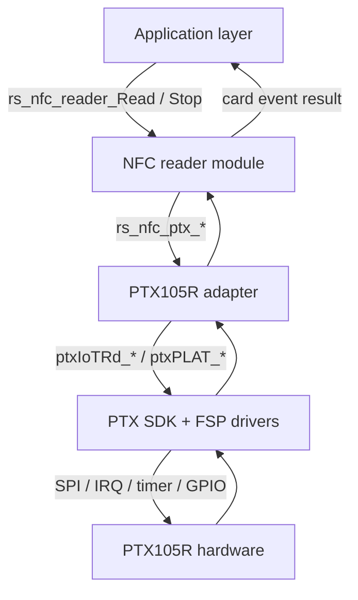

# NFC Door Lock — PTX105R

A ready-to-run, hardware-independent NFC card reader for Renesas RA microcontrollers with servo functionality to simulate a doorlock, built on the
PTX105R NFC front-end. The NFC workflow — discovery, activation, NDEF read, callback dispatch and
deactivation — is fully encapsulated in a reusable module with a two-function public API, so the
application never touches the PTX SDK.



| | |
|---|---|
| **NFC IC** | PTX105R — ISO 14443-A/B · NFC-F (FeliCa) · ISO 15693 |
| **Software** | Renesas FSP 6.5.0 + FreeRTOS 11.1.0 + `rm_nfc_reader_ptx_sdk` (PTX pack 3.0.0+fsp.6.5.0) |
| **Build** | e² studio CMake project · CMake + Ninja · Arm Toolchain for Embedded (LLVM / ATfE 21.1.1, picolibc) |
| **Reference board** | FPB-RA2E3 · `R7FA2E3073CFL` (Cortex-M23, 64 KB code flash) |
| **Additional HW** | SG90 Servo (NOTE: signal on P301)
| **Public API** | `rs_nfc_reader_Read()` · `rs_nfc_reader_Stop()` (single header) |
| **Scope** | Read-only reader — NDEF write/erase is not implemented |

---

## Table of Contents

1. [Overview](#overview)
2. [Features](#features)
3. [Requirements](#requirements)
4. [Build and Run](#build-and-run)
5. [Usage](#usage)
6. [Architecture](#architecture)
7. [Porting to Your Own Hardware](#porting-to-your-own-hardware)
8. [Error Handling](#error-handling)
9. [Limitations](#limitations)
10. [Troubleshooting](#troubleshooting)
11. [References](#references)

---

## Overview

Once running, the firmware continuously polls for NFC cards. On each detection it identifies the card
type and UID, attempts an NDEF read, decodes the NDEF records, fires an application callback, then
returns to polling — no code changes are needed when switching card types.

The NFC logic lives in `src/rs-nfc-card-reader/`. It is written against a single vendor HAL header, so
the PTX105R backend can be replaced without touching the protocol orchestration or the application.
The demo application in `src/app/` is a thin consumer: it configures the module, prints card
information over the debug console, and (optionally) toggles LEDs.

The module calls the PTX IoT-Reader SDK (`ptxIoTRd_*`) directly. The `RM_NFC_READER_PTX` FSP
wrapper is intentionally bypassed.

### Supported Tags

| NFC Standard | Tag Type | Example Cards |
|---|---|---|
| ISO 14443-A | Type 2 (T2T) | MIFARE Ultralight, NTAG21x |
| ISO 14443-A | Type 4A (T4A) | MIFARE DESFire, ISO-DEP |
| ISO 14443-B | Type 4B (T4B) | ISO 14443-4 Type B cards |
| NFC-F / FeliCa | Type 3 (T3T) | FeliCa Lite, FeliCa Standard |
| ISO 15693 | Type 5 (T5T) | NFC-V tags (ICODE SLIX, …) |

NDEF read is supported for all five tag types.

---

## Features

- **Two public functions** — `rs_nfc_reader_Read()` and `rs_nfc_reader_Stop()`.
- **One public header** — `rs_nfc_reader.h`; nothing else needs to be included by the application.
- **Blocking or non-blocking** — supplying a completion callback spawns a dedicated worker task and
  returns immediately; omitting it runs the read loop inline.
- **Static allocation in the module** — the worker task, its TCB and its 4 KB stack are statically
  allocated, and the NFC module never calls `malloc` — see [Heap](#heap).
- **Idle-free polling** — the read loop blocks on the reader IRQ (or a task notification from
  `Stop()`), not on a periodic timer.
- **NDEF decoded for you** — records are parsed into `result->decoded` before the card callback fires.
- **Vendor isolation** — all PTX105R specifics sit behind `ptx105r/rs_nfc_ptx105r.h`; replace the
  `ptx105r/` folder to move to another NFC front-end.
- **Optional raw exchange** — a protocol-appropriate raw frame exchange (T2T READ / T3T CHECK /
  T5T READ_SINGLE_BLOCK) can be enabled for diagnostics.

---

## Requirements

### Tools

| Tool | Notes |
|---|---|
| Renesas FSP **6.5.0** | Supplies the BSP, drivers and FreeRTOS port |
| PTX NFC pack `Renesas.PTX.3.0.0+fsp.6.5.0.pack` | Supplies `rm_nfc_reader_ptx` / `rm_nfc_reader_ptx_sdk`; must be installed in the FSP `internal/projectgen/ra/packs` folder, otherwise generation silently omits the NFC files |
| e² studio 2026-04 (or later) with FSP 6.5.0 | IDE, FSP configurator and bundled CMake 3.27.6 + Ninja |
| RA Smart Configurator (RASC) 6.5.0 | Only for command-line (non-e² studio) generation of `ra/`, `ra_gen/`, `ra_cfg/` |
| CMake ≥ 3.25 + Ninja | Command-line builds via `CMakePresets.json` |
| Arm Toolchain for Embedded (LLVM) 21.1.1 | `clang` / `ld.lld` with picolibc — `cmake/llvm.cmake` |
| Serial terminal | Optional, for the demo console output |

Environment variables consumed by the build:

| Variable | Points at | Required |
|---|---|---|
| `ARM_LLVM_TOOLCHAIN_PATH` (or `ARM_TOOLCHAIN_PATH`) | LLVM toolchain `bin` folder, e.g. `…\e2_studio\toolchains\llvm_arm\ATfE-21.1.1-Windows-x86_64\bin` | Yes |
| `RASC_EXE_PATH` | `rasc.exe` | Command-line builds only |

> [!NOTE]
> Inside e² studio, `Config.cmake` sets `RASC_EXE_PATH` to `echo` because the IDE runs the
> pre-/post-build steps itself. Outside e² studio, `Config.cmake` stops with a fatal error when
> `RASC_EXE_PATH` is not set.

### MCU Peripherals

The PTX105R integration is MCU-agnostic, but the target device must be able to provide:

| Resource | Purpose |
|---|---|
| SPI-capable channel (SCI in SPI mode) | PTX105R host interface — master, 1 MHz, CPOL=0, CPHA=0, MSB first |
| GPIO output | Chip select (active-low, software driven) |
| External IRQ-capable pin | Rising-edge interrupt from the PTX105R |
| DTC/DMAC channels (TX + RX) | Zero-CPU SPI transfers |
| 2 × GPT timer channels | PTX timing services |
| Regulated 3.3 V rail | PTX105R supply |
| UART channel *(optional)* | Console/log output only |
| 16-bit timer | Servo operation |

> [!IMPORTANT]
> The NFC module itself has **no UART dependency** and runs headless. UART is required only by the
> demo application's logging.

### Reference Configuration

The `configuration.xml` shipped with this project is generated for the following setup. It is a
starting point, not a constraint — re-target it to your own device and pin map as described in
[Porting to Your Own Hardware](#porting-to-your-own-hardware).

| Item | Value |
|---|---|
| Board | FPB-RA2E3 |
| Device / core | `R7FA2E3073CFL` · Arm Cortex-M23 (`CM23`) |
| FSP | 6.5.0 |
| Toolchain | LLVM (ATfE 21.1.1), picolibc |
| RTOS | FreeRTOS 11.1.0 (FSP `rm_freertos_port`), static + dynamic allocation, `heap_4` |
| SPI | SCI0 SPI master (`ptx_pmod_spi`) · 1 MHz · CPOL=0 · CPHA=0 · MSB first |
| PTX IRQ | External IRQ7 on P015, rising edge |
| Console UART | `g_uart_jlob_vcom` (SCI9) · 230400 8N1 |
| Linker script | `script/fsp.lld` (LLVM `ld.lld`) |

---

## Build and Run

### 1. Open the project

The project is an **e² studio CMake project** (not a managed-build project). Import it into an e²
studio 2026-04 (or later) workspace with FSP 6.5.0 and the PTX 3.0.0+fsp.6.5.0 pack installed. It
also carries Renesas365 metadata (`metadata.r365.xml`) and opens in VS Code via
`NFC_Reader_PTX105R.code-workspace`.

### 2. Generate FSP content

`ra/`, `ra_gen/`, `ra_cfg/` and `cmake/GeneratedCfg.cmake` / `cmake/GeneratedSrc.cmake` are
generated from `configuration.xml`. Regenerate once per fresh clone and again after editing
`configuration.xml`:

- **e² studio** — open `configuration.xml` and press **Generate Project Content**.
- **Command line** — with `RASC_EXE_PATH` pointing at RASC 6.5.0:

```bash
cmake -P cmake/prebuild.cmake
```

### 3. Configure and build

**In e² studio** — right-click the project → **Build Project** (or the hammer icon). The IDE uses its
bundled CMake 3.27.6 + Ninja, runs the FSP pre-build step (`bsp_linker_info.h`, `fsp_gen.lld`,
`memory_regions.lld`) and builds into `build/cmake.arm.debug.R7FA2E307/`.

**From the command line** — using the bundled presets (requires `ARM_LLVM_TOOLCHAIN_PATH` and
`RASC_EXE_PATH`):

```bash
cmake --preset DebugCI
cmake --build --preset DebugCI
```

Or explicitly:

```bash
cmake -DCMAKE_TOOLCHAIN_FILE=cmake/llvm.cmake -DCMAKE_BUILD_TYPE=Debug -G Ninja -B build/Debug
cmake --build build/Debug
```

A `ReleaseCI` preset is available as well. Artifacts are named after the CMake project
(`project(NFC_Reader_PTX105R …)` in `CMakeLists.txt`): `NFC_Reader_PTX105R.elf`, `.map`, `.hex` and
`.sbd`.

> [!WARNING]
> `CMakeLists.txt` replaces every RASC optimisation flag with **`-Oz`** in all build configurations.
> With RASC's default `-O2` the image is ~3 KB larger than the 64 KB code flash of the
> `R7FA2E3073CFL`; with `-Oz` about 0.5 KB remains free. The override lives in `CMakeLists.txt`
> because RASC rewrites `cmake/GeneratedCfg.cmake` on every generate.

`CMakeLists.txt` also adds the following on top of the RASC-generated files:

- `-Wl,--defsym=vfprintf=__l_vfprintf` — links picolibc's integer-only `printf` (the default
  float-capable one does not fit in flash).
- `-w` on vendor sources under `ra/renesas/` — the PTX SDK does not build cleanly with RASC's strict
  warning set; first-party `src/` warnings stay visible.
- Include paths for `src/rs-nfc-card-reader`, `src/rs-nfc-card-reader/ptx105r`, `src/app` and
  `src/rs-console-io`.
- A default `CMAKE_TOOLCHAIN_FILE` of `cmake/llvm.cmake` — e² studio does not pass a toolchain file,
  and without it CMake would pick up GCC.
- Conversion of `ARM_LLVM_TOOLCHAIN_PATH` / `ARM_TOOLCHAIN_PATH` to forward slashes — required by the
  CMake 3.27 bundled with e² studio.

### 4. Flash and debug

Debug with the on-board J-Link (FPB-RA2E3) using the e² studio debug launch configuration, or the
bundled VS Code / Theia launch configurations (`.vscode/launch.json`, `.theia/launch.json`, target
device `R7FA2E307`). Point the launch configuration's program/image at
`build/<config>/NFC_Reader_PTX105R.elf`. Execution reaches the application through:

```text
main()                       ← FSP generated
└─ new_thread0_entry()       ← FreeRTOS thread
   └─ app_nfc_reader_entry()
      └─ rs_nfc_reader_Read()  ← spawns the "RS_NFC" worker task
```

### 5. Observe

If the console UART is enabled, open a serial terminal at the configured baud (230400 8N1 by
default). On startup:

```text
System Initialization (RS NFC Reader) ... starting
RS NFC Reader launched (non-blocking)
```

Present a card to the antenna:

```text
CARD DETECTED! type=NFC-T4A UID=02840017810196 NDEF=15B
RF Technology  : TYPE A
Tag Type       : ISO-DEP (Type 4 Tag / ISO 14443-4)
Serial Number  : 02:84:00:17:81:01:96
Size           : 8192 bytes
Writeable      : Yes
NDEF           : 15 bytes
  NDEF raw (15 bytes): D1 01 0B 54 02 65 6E 59 4F 20 45 4C 49 4E 41
```

Optional LED feedback is compiled in via `APP_NFC_READER_LED_EN` in `src/app/app_nfc_reader.h`; both
configured LEDs are driven high while a card is being processed — comment the macro out to remove the
LED code entirely.

---

## Usage

### Starting the Reader

```c
#include "rs_nfc_reader.h"
#include <string.h>

/* Fires once per detected and activated card.
 * `result` and `summary` are valid ONLY inside this call — copy what you need. */
static void my_card_event (rs_status_t                  status,
                           const rs_nfc_card_result_t * result,
                           const char                 * summary,
                           void                       * p_context)
{
    (void)p_context;
    (void)status;

    if (NULL == result)         /* informational / warning event */
    {
        return;
    }

    if (result->ndef_present)
    {
        /* result->ndef_data holds result->ndef_len bytes,
         * result->decoded holds the parsed records. */
    }
}

/* Fires once when a non-blocking Read() completes. */
static void my_operation_done (rs_status_t status, void * p_context)
{
    (void)p_context;
    (void)status;
}

void app_start (void)
{
    rs_nfc_reader_cfg_t cfg;

    memset(&cfg, 0, sizeof(cfg));
    cfg.tech_mask             = RS_NFC_TECH_ALL;
    cfg.timeout_ms            = RS_NFC_TIMEOUT_INFINITE;
    cfg.retry_count           = RS_NFC_RETRY_DISABLED;
    cfg.read_ndef             = RS_NFC_NDEF_READ_ENABLED;
    cfg.max_ndef_bytes        = RS_NFC_NDEF_MAX_BYTES;
    cfg.run_raw_exchange      = RS_NFC_RAW_EXCHANGE_ENABLED;
    cfg.callback              = my_operation_done;   /* non-NULL => non-blocking */
    cfg.p_context             = RS_NFC_CONTEXT_NONE;
    cfg.on_card_event         = my_card_event;
    cfg.p_card_event_context  = RS_NFC_CONTEXT_NONE;
    cfg.validate_dependencies = RS_NFC_DEP_VALIDATION_DISABLED;
    cfg.cfg_valid_check_en    = RS_NFC_CFG_VALIDATION_ENABLED;

    /* Non-blocking: pass NULL for result_out so the worker uses its own
     * task-local buffer. A caller-local buffer would dangle on return. */
    (void)rs_nfc_reader_Read(&cfg, NULL);
}
```

Stop a running read at any time — from another task, an ISR-deferred handler, or a timeout:

```c
rs_status_t st = rs_nfc_reader_Stop();
```

### Configuration — `rs_nfc_reader_cfg_t`

| Field | Type | Meaning |
|---|---|---|
| `tech_mask` | `rs_nfc_tech_mask_t` | RF technologies to poll. Use `RS_NFC_TECH_ALL` or OR the individual `RS_NFC_TECH_*` flags. Must be non-zero. |
| `timeout_ms` | `uint32_t` | Run duration of `Read()`. `RS_NFC_TIMEOUT_INFINITE` loops forever. |
| `retry_count` | `uint8_t` | Per-operation retry budget. `RS_NFC_RETRY_DISABLED` (0) disables retries. |
| `read_ndef` | `bool` | Read and decode NDEF content for each detected card. |
| `max_ndef_bytes` | `uint16_t` | Upper bound on the NDEF payload copied into `result->ndef_data`; clamped to `RS_NFC_NDEF_MAX_BYTES` (512). |
| `run_raw_exchange` | `bool` | Perform a protocol-appropriate raw frame exchange after activation and expose it via `result->raw_exchange`. No effect for ISO-DEP. |
| `callback` | `rs_nfc_callback_t` | Completion callback. `NULL` selects blocking mode; non-`NULL` selects non-blocking mode. |
| `p_context` | `void *` | User context passed back to `callback`. |
| `on_card_event` | `rs_nfc_card_event_cb_t` | Per-card callback — the primary application hook. When set, the reader runs in continuous-loop mode. |
| `p_card_event_context` | `void *` | User context passed back to `on_card_event`. |
| `validate_dependencies` | `bool` | Check that the lower-level PTX105R stack is ready before starting. |
| `cfg_valid_check_en` | `bool` | Gate for config validation inside `Read()`. A `memset` to zero disables it, so set it explicitly to `true`. |

### Result — `rs_nfc_card_result_t`

| Field | Type | Meaning |
|---|---|---|
| `card_type` | `rs_nfc_card_type_t` | Normalised classification (T2T, T3T, T4A, T4B, T5T, …). |
| `protocol` | `ptxIoTRd_CardProtocol_t` | Active RF protocol reported by the PTX SDK. |
| `uid` / `uid_len` | `uint8_t[10]` / `uint8_t` | Card UID and its valid length. |
| `ndef_present` | `bool` | An NDEF message was found on the card. |
| `ndef_data` / `ndef_len` | `uint8_t[512]` / `uint16_t` | Raw NDEF message buffer and its length. |
| `decoded` | `rs_ndef_decoded_t` | Parsed NDEF records (up to 8). Each record's `payload` points into `ndef_data`. |
| `rssi_dbm` | `int8_t` | Optional RF signal strength; `0` when unsupported. |
| `read_time_ms` | `uint32_t` | Time spent on the current card event. |
| `data_area_size` | `uint32_t` | Tag capacity derived from the capability container. |
| `writeable` | `bool` | Tag reports write access (informational — this firmware never writes). |
| `tag_type_name` | `const char *` | Human-readable tag description. Static string; do not free. |
| `raw_exchange` | `rs_nfc_raw_exchange_t` | Last raw exchange snapshot. Check `.valid` before use. |

> [!IMPORTANT]
> The result struct and the `summary` string are **reused on the next card event**. Copy anything you
> need before the callback returns, and never retain the `decoded[].payload`, `raw_exchange.tx` or
> `raw_exchange.rx` pointers.

---

## Architecture

### Layers

| Layer | Responsibility | Key files |
|---|---|---|
| Application | Product behaviour — logging, LEDs, when to read | `src/app/`, `src/new_thread0_entry.c` |
| NFC reader module | NFC state machine: discover → activate → read → callback → deactivate | `src/rs-nfc-card-reader/rs_nfc_reader.c`, `rs_ndef_read.c` |
| PTX105R adapter | Translates module calls into PTX SDK operations | `src/rs-nfc-card-reader/ptx105r/` |
| PTX SDK + FSP drivers | NFC protocol engine and MCU peripheral access | `ptxIoTRd_*`, `ptxPLAT_*`, SCI SPI, external IRQ, GPT, DTC |
| Hardware | RF front-end and MCU | PTX105R + RA MCU |



One runtime cycle: the application starts the reader, the worker task configures and starts
discovery, blocks on the reader IRQ, activates the detected card, reads card info and NDEF, fires
`on_card_event`, deactivates the card and returns to discovery.

### Project Layout

```text
pes-nfc-card-reader/
├── src/
│   ├── hal_entry.c                    BSP warm-start hook and FreeRTOS hooks
│   ├── new_thread0_entry.c            RTOS thread that starts the application
│   ├── app/
│   │   ├── app_nfc_reader.c/.h        App entry, card-event callback, LED helpers
│   │   └── app_nfc_reader_log.c/.h    Console log and card-info printing
│   ├── rs-nfc-card-reader/
│   │   ├── rs_nfc_reader.h            Public API — the single include
│   │   ├── rs_nfc_reader.c            Orchestrator + "RS_NFC" worker task
│   │   ├── rs_ndef_read.c             NDEF read + record decode
│   │   └── ptx105r/
│   │       ├── rs_nfc_ptx105r.c       PTX105R backend (direct ptxIoTRd_* calls)
│   │       ├── rs_nfc_ptx105r.h       Vendor HAL contract — the porting seam (also declares the
│   │       │                          module-internal rs_ndef_read_card_info())
│   │       └── rs_nfc_ptx105r_board.h Integrator-supplied board symbols
│   └── rs-console-io/
│       ├── syscalls_picolib_stdio_to_uart.c  picolibc stdio retarget over UART
│       └── r_byteq.c/.h               UART transmit ring buffer
├── cmake/
│   ├── llvm.cmake                     [generated] LLVM (ATfE) toolchain file
│   ├── GeneratedCfg.cmake             [generated] compiler/linker flags
│   ├── GeneratedSrc.cmake             [generated] source globs and targets
│   └── prebuild.cmake                 [generated] headless RASC generation
├── script/fsp.lld                     Linker script (ld.lld)
├── configuration.xml                  FSP 6.5.0 stacks + pin configuration
├── metadata.r365.xml                  Renesas365 PES metadata
├── CMakeLists.txt / CMakePresets.json / CMakeProject.json / Config.cmake
├── ra/                                [generated] FSP, CMSIS, FreeRTOS, PTX SDK
├── ra_gen/                            [generated] FSP project content
└── ra_cfg/                            [generated] FSP configuration headers
```

> [!CAUTION]
> Never hand-edit `ra/`, `ra_gen/` or `ra_cfg/`. They are regenerated whenever `configuration.xml`
> is saved or `cmake/prebuild.cmake` runs.

### FreeRTOS Tasks

FreeRTOS is required for non-blocking operation, because `rs_nfc_reader_Read()` creates and runs the
`RS_NFC` worker task.

| Task | Created by | Stack | Priority | Role |
|---|---|---|---|---|
| `new_thread0` | FSP (static) | 1 KB | 1 | Calls `app_nfc_reader_entry()`, then suspends |
| app_thread | FSP (static) | 1 KB | 2 | Initializes servo lib, activates door lock upon NFC |
| `RS_NFC` | `rs_nfc_reader_Read()` | 4 KB (static) | 1 | Runs the full NFC event loop; self-deletes on stop |
| `IDLE` | FreeRTOS kernel | 512 B | 0 | Kernel idle task |

> [!NOTE]
> All task stacks are statically allocated — `configSUPPORT_STATIC_ALLOCATION` must be `1`. Do not
> reduce the `RS_NFC` stack below 4096 bytes; protocol and NDEF paths are deep.

### Heap

The project has two independent heaps:

- **FreeRTOS `heap_4`** — `configTOTAL_HEAP_SIZE` = 2048 bytes. Used by the kernel for dynamically
  created objects. All task stacks in this project are static, so it is lightly used.
- **BSP / picolibc heap** — `config.bsp.common.heap` = 256 bytes. Serves the C library `malloc`
  (no `malloc` → `pvPortMalloc` aliasing is applied in this project). The NFC Reader PTX module
  requires this heap to be > 0; `src/rs-console-io/` allocates its UART transmit buffer from it.

Keep both values in mind when adding code — the `R7FA2E3073CFL` has 16 KB of SRAM and the current
image already uses about 14 KB of `.bss`.

---

## Porting to Your Own Hardware

The application layer, the NFC module and the NDEF layer are portable as-is. Integration work is
concentrated in `configuration.xml` and the two board-facing files.

1. **Select the target device** in the `configuration.xml` BSP tab, then confirm against the device
   hardware manual that the peripherals listed in [MCU Peripherals](#mcu-peripherals) are available
   and not claimed by another function.
2. **Map the pins and channels** to your schematic for SPI (MISO/MOSI/SCK/CS), the PTX IRQ, the reset
   GPIO and — if used — the console UART. Update the Stacks and Pins tabs, then regenerate: changing
   the SPI channel also requires reassigning the DTC transfer instances, and changing the IRQ pin
   regenerates the vector table and common data.
3. **Import only the layers you need.** Always required: `src/rs-nfc-card-reader/` including
   `ptx105r/`. Optional: `src/app/` and `src/rs-console-io/` — replace them with your own application
   and I/O if you do not want the demo behaviour. `src/rs-console-io/` is picolibc-specific (LLVM
   toolchain); it does not build with GCC/newlib. Never copy `ra/`, `ra_gen/` or `ra_cfg/` — generate
   them for your own project.

| Signal | What can change | Where to update |
|---|---|---|
| SPI (MISO/MOSI/SCK/CS) | Any SPI-capable SCI channel and pin group | `configuration.xml` — Stacks + Pins |
| DTC transfer instances | Must match the selected SPI channel's transfer request lines | `configuration.xml` — Stacks |
| PTX IRQ | Any external-IRQ-capable pin | `configuration.xml` — Stacks + Pins; the adapter picks up `g_ext_irq` through `rs_nfc_ptx105r_board.h` |
| PTX reset | Any GPIO output pin | `configuration.xml` — Pins |
| Console UART | Any UART-capable channel, or omit entirely | `configuration.xml`; `src/app/app_nfc_reader_log.c`, `src/rs-console-io/` |
| Timers | Any two free GPT channels for the PTX timing services | `configuration.xml` — Stacks |

`rs_nfc_ptx105r_board.h` is the integrator's hook: it declares the external IRQ instance and the PTX
GPIO ISR callback the adapter binds to. Point it at your own instance names if you rename them.

When moving to a **different RA device**, also re-verify the clock configuration and the linker
script, and confirm the flash budget — the PTX NFC stack is large.

### Integration Checklist

- [ ] BSP device and package match your hardware.
- [ ] SPI instance configured as master, 1 MHz, CPOL=0, CPHA=0, MSB first, with an active-low GPIO chip select.
- [ ] DTC/DMAC TX and RX instances enabled and matched to the SPI channel.
- [ ] External IRQ instance configured on the PTX IRQ pin with rising-edge trigger.
- [ ] Two GPT channels allocated for the PTX timing services.
- [ ] Reset GPIO configured as an output.
- [ ] UART instance present only if console output is needed; terminal baud matches the FSP setting.
- [ ] `configSUPPORT_STATIC_ALLOCATION = 1`, `configSUPPORT_DYNAMIC_ALLOCATION = 1`, and the FreeRTOS heap sized for your workload.
- [ ] BSP heap (`config.bsp.common.heap`) > 0 (see [Heap](#heap)); on small-flash parts, carry over `-Oz` and `-Wl,--defsym=vfprintf=__l_vfprintf`.
- [ ] Project links with no unresolved NFC, SPI, IRQ, DTC or UART symbols, and the image fits in flash.

---

## Error Handling

The module reports status through the `rs_status_t` enum in `rs_nfc_reader.h`.

| Status | Cause | Recovery |
|---|---|---|
| `RS_OK` | Success | — |
| `RS_ERR_TIMEOUT` | Card removed, or the polling window expired | Continue polling / retry |
| `RS_ERR_INVALID_CFG` | Malformed `rs_nfc_reader_cfg_t` | Fix the offending fields; keep `cfg_valid_check_en = true` |
| `RS_ERR_DEPENDENCY` | Lower PTX105R stack not ready, or `Stop()` called with no read in progress | Verify the FSP stack configuration |
| `RS_ERR_NOT_FOUND` | Card is not NDEF-formatted | Log and continue polling |
| `RS_ERR_BUFFER_OVERFLOW` | NDEF message larger than `max_ndef_bytes` | Increase `max_ndef_bytes` (≤ `RS_NFC_NDEF_MAX_BYTES`) |
| `RS_ERR_INTERNAL` | Second non-blocking `Read()` while one is active, duplicate `Stop()`, or internal fault | Stop the running read first; reset the PTX105R if it persists |

---

## Limitations

- **Read-only** — NDEF write and erase are not implemented for any tag type.
- **SPI transport only** — validated with SCI in SPI mode; dedicated SPI peripherals are not supported in this release.
- **One card per cycle** — only a single card can be activated per read cycle.
- **NDEF size** — capped by `RS_NFC_NDEF_MAX_BYTES` (512) and by on-tag memory; up to 8 records are decoded.
- **Single active read** — only one non-blocking `Read()` may be in flight at a time.
- **ISO 15693** — basic detection and NDEF read; advanced features (AFI, DSFID) are not implemented.

---

## Troubleshooting

**No cards detected**
- Verify the PTX105R 3.3 V supply and antenna connection.
- Confirm the SPI pins, chip select and IRQ pin match `configuration.xml` and your schematic.
- Check the return code of `rs_nfc_ptx_start_discovery()` in the debugger.

**Console output missing**
- Confirm the terminal baud matches the FSP UART setting (230400 8N1 by default).
- Confirm the UART instance exists in the FSP stack and the correct port is open.

**Build fails with a flash overflow**
- Confirm the `-Oz` override and the `vfprintf=__l_vfprintf` link option are still in `CMakeLists.txt`; RASC overwrites flags placed in `cmake/GeneratedCfg.cmake`.

**Intermittent read failures**
- Increase `cfg.timeout_ms` for slower cards, and check the antenna tuning and card distance.

**Stack overflow or hard fault under load**
- Do not reduce the `RS_NFC` task stack below 4096 bytes, and leave headroom in the FreeRTOS heap.

---

## References

| Document | Description |
|---|---|
| [PTX105R product page](https://www.renesas.com/en/products/ptx105r) | Mid-power, multi-protocol NFC Forum compliant reader |
| [PTX105R datasheet](https://www.renesas.com/en/document/dst/ptx105r-datasheet) | Electrical and RF specifications |
| [Renesas FSP documentation](https://renesas.github.io/fsp/) | API reference for all FSP modules used |
| [RA Smart Configurator](https://www.renesas.com/en/software-tool/ra-smart-configurator) | FSP configuration and code generation tool |
| [e² studio](https://www.renesas.com/en/software-tool/e2-studio) | Renesas IDE user guide and downloads |
| [J-Link software](https://www.segger.com/products/debug-probes/j-link/tools/j-link-software/) | SEGGER debug probe tools |

**Support**

- [Renesas Wireless Connectivity Forum](https://community.renesas.com/wireles-connectivity)
- [Technical Support](https://www.renesas.com/support)
